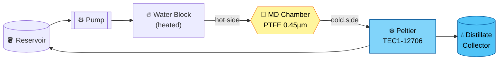
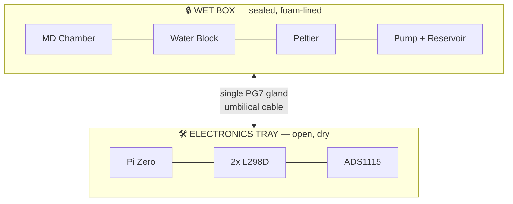

<div align="center">

# 💧 NeuraVapor

### Closed-Loop Waste-Heat-to-Water Recovery & Noise-Adaptive Cooling for Data Centers

**with a Live 3D Digital Twin**

[](#-status)
[](#-budget)
[](#-timeline)
[](#-license)

[](#-hardware)
[](#-digital-twin)
[](#-software-stack)
[](#-contributing)

*Turns data center waste heat into recovered water — closed loop, zero external inlet/outlet.*

<sub>Engineering Clinics Capstone · Hardware Engineering, 3rd Year</sub>

---

</div>

## ⚡ TL;DR

> Data centers dump 15–50% of their water intake into evaporative cooling. NeuraVapor recovers it instead — using **membrane distillation** to turn waste heat directly into distilled water, in a sealed loop that never touches an external supply. A noise-adaptive control loop keeps pumps and fans quiet, and a **live 3D digital twin** lets you watch temperature, flow, and noise animate in your browser in real time.

```
   waste heat  →  membrane distillation  →  recovered water
        └──────────── closed loop, no external I/O ────────────┘
```

<div align="center">

| 🌡️ Recovers water from heat | 🔇 Adapts to stay quiet | 🖥️ Streams a live 3D twin |
|:---:|:---:|:---:|
| PTFE membrane distillation | Sound-sensor-driven PWM control | Three.js + WebSocket dashboard |

</div>

---

## 📖 Table of Contents

<details>
<summary><b>Click to expand</b></summary>

- [Why This Exists](#-why-this-exists)
- [How It Works](#-how-it-works)
- [System Architecture](#️-system-architecture)
- [Hardware](#-hardware)
- [Wiring](#-wiring)
- [Build It Yourself](#️-build-it-yourself)
- [Software Stack](#-software-stack)
- [Digital Twin](#-digital-twin)
- [Budget](#-budget)
- [Timeline](#-timeline)
- [Regulatory Landscape](#-regulatory-landscape)
- [Repo Structure](#-repo-structure)
- [Status](#-status)
- [Contributing](#-contributing)
- [License](#-license)

</details>

---

## 🌍 Why This Exists

<table>
<tr>
<td width="33%" valign="top">

### 💧 Water
Evaporative cooling eats **15–50%** of a data center's water intake. Oregon's 2026 groundwater settlement: **$20.5M**.

</td>
<td width="33%" valign="top">

### 🔊 Noise
Community lawsuits over pump/fan/generator noise filed across **3 US states** in 2026 alone.

</td>
<td width="33%" valign="top">

### 📜 Regulation
Germany's **EnEfG** mandates 10% heat reuse *now*, 20% by 2028. Virginia's **HB323** is the first US law of its kind.

</td>
</tr>
</table>

NeuraVapor is a feasibility prototype aimed squarely at all three, at once, on a ₹6–7K budget.

---

## 🔧 How It Works

<div align="center">



</div>

1. 🪣 Pump pulls water from the reservoir
2. 🔥 Resistor bank heats it at the water block (simulated DC load)
3. 🧪 Hot water crosses the PTFE membrane — vapor passes, liquid can't
4. ❄️ Peltier cools the far side, condensing the vapor
5. 💧 Distillate drips into the collector — **your recovered water**
6. ♻️ Cooled water loops back to the reservoir. No drain, no tap, ever.

> **Zero external inlet/outlet.** This is a fully closed recirculating system.

---

## 🏗️ System Architecture

Two physically separate modules, one umbilical cable:

<div align="center">



</div>

**Why split it?** A leak in the wet box can never take out the control electronics — and the tray stays fully serviceable without cracking the seal.

---

## 🔩 Hardware

<details>
<summary><b>🧊 Wet box structure</b></summary>

| Item | Spec |
|---|---|
| ABS junction box | 280×190×130mm, clear PC cover |
| Acrylic sheet | 3mm, 6×6" ×4 (2 working + 2 spare) |
| PTFE membrane | 0.45µm, 25mm dia |
| Silicone sealant | Water-safe |
| Silicone tubing | 6mm ID / 8mm OD |
| PG7 cable gland | ×1 |

</details>

<details>
<summary><b>🌡️ Cooling / heat assembly</b></summary>

| Item | Spec |
|---|---|
| Aluminum water block | 40×40mm |
| Aluminum heat sink | 40×40×20mm |
| Peltier module | TEC1-12706 |
| Cooling fan | 12V, 4010 |
| Resistor heat bank | — |
| Submersible pump | 12V DC |

</details>

<details>
<summary><b>📡 Sensors</b></summary>

| Sensor | Qty |
|---|:---:|
| DS18B20 waterproof temp probe | 2 |
| Water flow sensor | 1 |
| Sound sensor (KY-038) | 1 |
| Water level sensor | 1 |

</details>

<details>
<summary><b>🖥️ Electronics tray</b></summary>

| Item | Qty |
|---|:---:|
| Raspberry Pi Zero | 1 |
| L298D motor driver | 2 |
| ADS1115 ADC | 1 |
| 4.7kΩ pull-up (DS18B20) | 1 |
| 1kΩ+2kΩ divider (flow sensor) | 1 |

</details>

> ℹ️ **Deck vs. build guide:** the original proposal spec'd an Arduino Uno + Python/Flask serial bridge. The as-built rig moved to a **Pi Zero** running control directly — treat the wiring below as the source of truth.

---

## ⚡ Wiring

<details open>
<summary><b>Motor drivers (2× L298D)</b></summary>

Each channel: `IN1→3.3V (HIGH)` · `IN2→GND (LOW)` · `EN→GPIO (PWM)`

| Load | GPIO | Pin |
|---|:---:|:---:|
| 💧 Pump | GPIO18 | 12 |
| ❄️ Peltier | GPIO13 | 33 |
| 🔥 Resistor bank | GPIO12 | 32 |
| 🌀 Fan | GPIO19 | 35 |

</details>

<details>
<summary><b>DS18B20 ×2 (1-Wire)</b></summary>

`Red→3.3V` · `Black→GND` · `Yellow→GPIO4 (Pin 7)` + 4.7kΩ pull-up to 3.3V

</details>

<details>
<summary><b>ADS1115</b></summary>

`VDD→3.3V` · `GND→GND` · `SCL→GPIO3 (Pin 5)` · `SDA→GPIO2 (Pin 3)` · `A0→Sound` · `A1→Water level`

</details>

---

## 🛠️ Build It Yourself

```
✅ 1. Parts checklist        confirm everything before starting
✅ 2. MD chamber              acrylic + membrane, star-bolt, 24h cure
✅ 3. Cooling assembly         heat sink → water block → Peltier polarity check
✅ 4. Electronics tray         Pi + drivers + ADS1115 on a rigid base
✅ 5. Umbilical cable          single PG7 gland, quick-disconnect terminal
✅ 6. Wiring                   breadboard first, then permanent
✅ 7. Bench test               i2cdetect -y 1 → expect `48`
✅ 8. Leak test                15+ min, fully dry
✅ 9. Final assembly           foam, vibration pad, gland seal
✅ 10. Power-on checklist      full pre-flight before first live run
```

<details>
<summary><b>🚦 Full power-on checklist</b></summary>

- [ ] DS18B20 ×2 wired and reading
- [ ] No short between 12V and GND on either driver
- [ ] Peltier polarity re-confirmed after final mounting
- [ ] All GND joined at one common point
- [ ] Pull-up resistor on DS18B20 data line
- [ ] Voltage divider on flow sensor (if 5V)
- [ ] ADS1115 detected via `i2cdetect`
- [ ] Loop leak-tested 15+ min, fully dry
- [ ] Umbilical connector seated, gland tightened
- [ ] Tray secured, ports accessible
- [ ] Nothing electrical in a splash zone

</details>

---

## 💻 Software Stack

| Layer | Stack | Job |
|---|---|---|
| 🔌 Serial Bridge | `pyserial` + Flask | Sensor data → WebSocket stream |
| 🌐 Digital Twin | Three.js + WebSocket | Live animated 3D rig |
| 🧠 Control Loop | Python (Pi) / C++ (Arduino) | Adaptive pump + Peltier PWM |
| 📦 Libraries | OneWire, Flask, Three.js, WebSocket | 100% open-source, ₹0 cost |

**Live streams:** 2× temperature · 1× acoustic noise → dashboard, in real time.

---

## 🌐 Digital Twin

> 🎬 *Drop a GIF or screen recording of the dashboard here once it's live.*

```
┌────────────────────────────────────────┐
│   🌡️ Hot Side: 62°C   ❄️ Cold Side: 18°C  │
│   💧 Flow: 0.4 L/min   🔊 Noise: 41 dB     │
│   [========== animated 3D rig ==========]  │
└────────────────────────────────────────┘
```

Real-time WebSocket feed → Three.js scene → animated water flow, temperature gradients, and noise-level indicators rendered live in the browser.

---

## 💰 Budget

<div align="center">

| Category | ₹ |
|---|---:|
| 🧠 Brain & sensing | 1,230 |
| 🔥 Heat source | 480 |
| 💧 Cooling loop | 870 |
| 🧪 MD chamber | 1,250 |
| ❄️ Cold side | 430 |
| 🔇 Acoustic + enclosure | 1,180 |
| ⚡ Power & safety | 440 |
| 📏 Measurement | 100 |
| **Hardware total** | **≈ 5,980–6,900** |
| 💻 Software | **0** (open-source) |
| **Grand total** | **≈ ₹6,000–7,000** |

</div>

---

## 📅 Timeline

<div align="center">

`Week 1` 🛒 → `Week 2-3` 💧 → `Week 3-4` 🧪 → `Week 4-5` 📡 → `Week 5-7` 🧠🌐 → `Week 7` 🔇 → `Week 8` 🔗 → `Week 9` 📊 → `Week 10` 📄

</div>

| Week | Deliverable |
|:---:|---|
| 1 | Controller configured, serial comms tested |
| 2 | Adjustable heat load via PWM |
| 2–3 | Leak-free closed loop |
| 3–4 | Sealed MD chamber + Peltier installed |
| 4–5 | Calibrated temp + noise sensors |
| 5–6 | Adaptive control loop live |
| 6–7 | 3D dashboard end-to-end |
| 7 | Enclosure + acoustic treatment |
| 8 | Full system integration |
| 9 | Performance data collected |
| 10 | Final report + demo |

---

## 📜 Regulatory Landscape

| 🌍 | Regulation | Requirement |
|---|---|---|
| 🇩🇪 Germany | EnEfG (Jul 2026) | 10% heat reuse now → 20% by 2028 |
| 🇺🇸 Virginia | HB323 | First US mandatory heat-reuse law |
| 🇺🇸 Oregon | 2026 Settlement | $20.5M — water externalities now cost money |

---

## 📁 Repo Structure

```
neuravapor/
├── README.md
├── docs/
│   ├── build-guide.md
│   ├── wet-part-layout.png
│   └── project-deck.pptx
├── firmware/
│   └── control-loop/
├── software/
│   ├── serial-bridge/       # pyserial + Flask
│   └── digital-twin/        # Three.js dashboard
├── hardware/
│   ├── bom.csv
│   ├── wiring-diagram.png
│   └── tubing-cut-plan.csv
└── data/
    └── test-logs/
```

---

## 🚦 Status

<div align="center">


</div>

---

## 🤝 Contributing

Issues and PRs welcome — especially around control-loop tuning, membrane sourcing, and dashboard visuals.

---

## 📄 License

*Add your chosen license — MIT for code, CERN-OHL for hardware designs.*

<div align="center">

---

**NeuraVapor** · Built to prove waste heat doesn't have to be waste.

</div>
