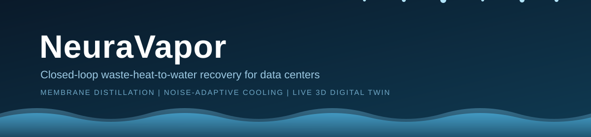
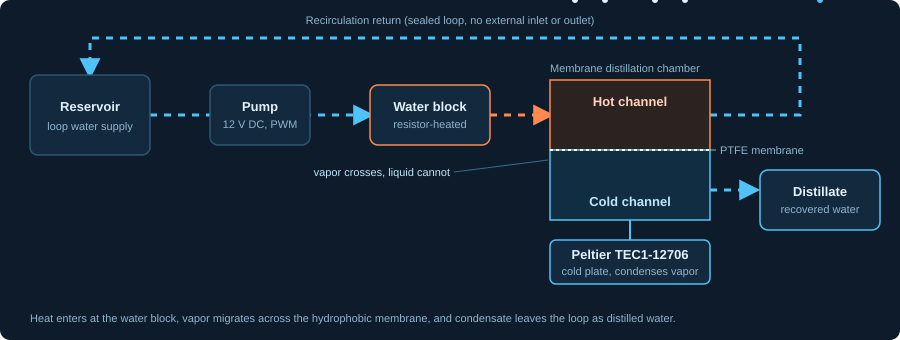
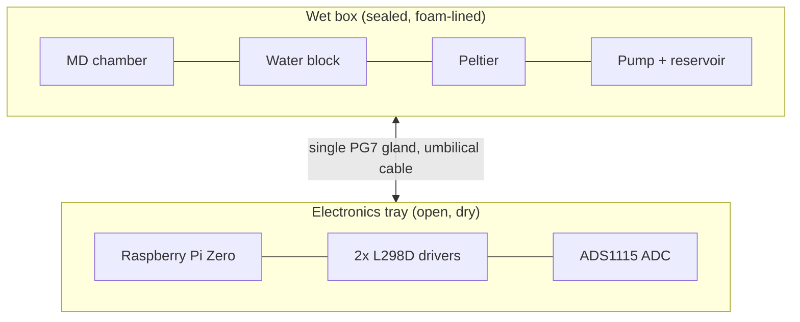

<p align="center">
  
</p>

<p align="center">
  
  
  
  
  
  
</p>

<p align="center">
  <em>Engineering Clinics Capstone &middot; Hardware Engineering, 3rd Year</em>
</p>

---

## Overview

Data centers reject enormous amounts of heat, and most facilities remove it by evaporating water. NeuraVapor is a feasibility prototype that treats that heat as a resource instead. It uses **membrane distillation** to convert waste heat directly into distilled water inside a sealed, recirculating loop that has no external inlet or outlet.

Two further constraints shape the design. Pumps and fans are a common source of community noise complaints, so the control loop is **noise-adaptive**: it reads an acoustic sensor and modulates actuator power to stay quiet. And because a thermal system is hard to reason about from raw numbers, the rig streams its sensor data to a **live 3D digital twin** that animates temperature, flow, and noise in the browser.

The whole prototype is built on a budget of roughly INR 6,000 to 7,000.

---

## Motivation

| Water | Noise | Regulation |
|---|---|---|
| Evaporative cooling consumes 15 to 50 percent of a data center's water intake. Oregon's 2026 groundwater settlement was **$20.5M**. | Community lawsuits over pump, fan, and generator noise were filed across **three US states** in 2026. | Germany's **EnEfG** requires 10 percent heat reuse now and 20 percent by 2028. Virginia's **HB323** is the first US law of its kind. |

NeuraVapor targets all three pressures at once, at prototype scale.

---

## How It Works

<p align="center">
  
</p>

The water circuit is a single closed loop:

1. **Circulation.** A 12 V pump draws water from the reservoir and pushes it through the loop.
2. **Heating.** At the aluminum water block, a resistor bank stands in for the heat produced by a data center load.
3. **Vapor transport.** Hot water flows across one face of a hydrophobic PTFE membrane (0.45 &micro;m). The membrane blocks liquid but lets water vapor pass through the pores, driven by the temperature difference across it.
4. **Condensation.** A Peltier module chills the far side of the membrane, so the vapor condenses back into liquid.
5. **Recovery.** The condensate drips into a collector. This is the recovered, distilled water.
6. **Return.** The remaining water travels back to the reservoir and the cycle repeats. Nothing is drained and nothing is topped up from a tap.

---

## System Architecture

The prototype is split into two physically separate modules joined by a single umbilical cable.



The split is deliberate. A leak in the wet box cannot reach the control electronics, and the tray stays fully serviceable without breaking the seal on the water loop.

### Control strategy

The Raspberry Pi Zero drives four PWM channels (pump, Peltier, resistor bank, fan) through the L298D drivers and reads two DS18B20 temperature probes, a flow sensor, a water level sensor, and a sound sensor. The adaptive loop balances two goals: keep the hot-to-cold temperature difference high enough for distillation, and keep acoustic output low by scaling pump and fan duty against the measured noise level.

> **Design note.** The original proposal specified an Arduino Uno with a Python/Flask serial bridge. The as-built rig moved to a Raspberry Pi Zero that runs control directly. Where the two differ, the wiring section below is the source of truth.

---

## Hardware

<details>
<summary><strong>Wet box structure</strong></summary>

| Item | Specification |
|---|---|
| ABS junction box | 280 x 190 x 130 mm, clear PC cover |
| Acrylic sheet | 3 mm, 6 x 6 in, quantity 4 (2 working, 2 spare) |
| PTFE membrane | 0.45 &micro;m, 25 mm diameter |
| Silicone sealant | Water-safe |
| Silicone tubing | 6 mm ID / 8 mm OD |
| Cable gland | PG7, quantity 1 |

</details>

<details>
<summary><strong>Heating and cooling assembly</strong></summary>

| Item | Specification |
|---|---|
| Aluminum water block | 40 x 40 mm |
| Aluminum heat sink | 40 x 40 x 20 mm |
| Peltier module | TEC1-12706 |
| Cooling fan | 12 V, 4010 |
| Resistor heat bank | Simulated DC load |
| Submersible pump | 12 V DC |

</details>

<details>
<summary><strong>Sensors</strong></summary>

| Sensor | Quantity |
|---|:---:|
| DS18B20 waterproof temperature probe | 2 |
| Water flow sensor | 1 |
| Sound sensor (KY-038) | 1 |
| Water level sensor | 1 |

</details>

<details>
<summary><strong>Electronics tray</strong></summary>

| Item | Quantity |
|---|:---:|
| Raspberry Pi Zero | 1 |
| L298D motor driver | 2 |
| ADS1115 ADC | 1 |
| 4.7 k&Omega; pull-up (DS18B20 data line) | 1 |
| 1 k&Omega; + 2 k&Omega; voltage divider (flow sensor) | 1 |

</details>

---

## Wiring

**Motor drivers (2x L298D).** On every channel, `IN1` connects to 3.3 V (HIGH), `IN2` to GND (LOW), and `EN` to a PWM-capable GPIO.

| Load | GPIO | Physical pin |
|---|:---:|:---:|
| Pump | GPIO18 | 12 |
| Peltier | GPIO13 | 33 |
| Resistor bank | GPIO12 | 32 |
| Fan | GPIO19 | 35 |

**DS18B20 temperature probes (1-Wire, x2).** Red to 3.3 V, black to GND, yellow to GPIO4 (pin 7), with a 4.7 k&Omega; pull-up from the data line to 3.3 V.

**ADS1115 (I2C).**

| ADS1115 pin | Connection |
|---|---|
| VDD | 3.3 V |
| GND | GND |
| SCL | GPIO3 (pin 5) |
| SDA | GPIO2 (pin 3) |
| A0 | Sound sensor |
| A1 | Water level sensor |

---

## Build Guide

The build follows ten stages, from parts verification to the first live run.

1. **Parts checklist.** Confirm every component before starting.
2. **MD chamber.** Assemble the acrylic and membrane stack with star-pattern bolting, then allow a 24 hour sealant cure.
3. **Cooling assembly.** Mount the heat sink, water block, and Peltier, and verify Peltier polarity.
4. **Electronics tray.** Mount the Pi, drivers, and ADS1115 on a rigid base.
5. **Umbilical cable.** Route a single PG7 gland with a quick-disconnect terminal.
6. **Wiring.** Prototype on a breadboard first, then move to permanent connections.
7. **Bench test.** Run `i2cdetect -y 1` and expect the ADS1115 at address `48`.
8. **Leak test.** Run the loop for at least 15 minutes and confirm everything stays dry.
9. **Final assembly.** Add foam lining, the vibration pad, and the gland seal.
10. **Power-on checklist.** Complete the pre-flight list below before the first live run.

<details>
<summary><strong>Power-on checklist</strong></summary>

- [ ] Both DS18B20 probes wired and reading
- [ ] No short between 12 V and GND on either driver
- [ ] Peltier polarity re-confirmed after final mounting
- [ ] All grounds joined at one common point
- [ ] Pull-up resistor fitted on the DS18B20 data line
- [ ] Voltage divider fitted on the flow sensor (if it outputs 5 V)
- [ ] ADS1115 detected via `i2cdetect`
- [ ] Loop leak-tested for 15+ minutes, fully dry
- [ ] Umbilical connector seated and gland tightened
- [ ] Tray secured with ports accessible
- [ ] Nothing electrical in a splash zone

</details>

---

## Software Stack

| Layer | Technology | Responsibility |
|---|---|---|
| Control loop | Python on Raspberry Pi Zero | Adaptive pump and Peltier PWM, sensor acquisition |
| Data bridge | Flask + WebSocket (`pyserial` only if an external microcontroller is used) | Streams sensor data to the dashboard |
| Digital twin | Three.js + WebSocket | Live animated 3D model of the rig |
| Libraries | OneWire, Flask, Three.js | Fully open-source, zero licensing cost |

Live streams: two temperature channels and one acoustic noise channel.

---

## Digital Twin

The digital twin is a browser-based 3D scene fed by a WebSocket stream from the rig. It is designed to animate water flow, temperature gradients across the hot and cold sides, and a live noise indicator, so that the state of the system is readable at a glance.

Planned dashboard layout:

```
+--------------------------------------------------+
|  Hot side: 62 C        Cold side: 18 C           |
|  Flow: 0.4 L/min       Noise: 41 dB              |
|                                                  |
|            [ animated 3D rig view ]              |
+--------------------------------------------------+
```

*Values above are illustrative placeholders. A screen recording will replace this block once the dashboard is running.*

---

## Budget

| Category | Cost (INR) |
|---|---:|
| Brain and sensing | 1,230 |
| Heat source | 480 |
| Cooling loop | 870 |
| MD chamber | 1,250 |
| Cold side | 430 |
| Acoustic treatment and enclosure | 1,180 |
| Power and safety | 440 |
| Measurement | 100 |
| **Hardware total** | **5,980 to 6,900** |
| Software | 0 (open-source) |
| **Grand total** | **approx. 6,000 to 7,000** |

---

## Timeline

| Week | Deliverable |
|:---:|---|
| 1 | Controller configured, serial communication tested |
| 2 | Adjustable heat load via PWM |
| 2 to 3 | Leak-free closed loop |
| 3 to 4 | Sealed MD chamber and Peltier installed |
| 4 to 5 | Calibrated temperature and noise sensors |
| 5 to 6 | Adaptive control loop live |
| 6 to 7 | 3D dashboard working end to end |
| 7 | Enclosure and acoustic treatment |
| 8 | Full system integration |
| 9 | Performance data collected |
| 10 | Final report and demonstration |

---

## Regulatory Context

| Jurisdiction | Regulation | Requirement |
|---|---|---|
| Germany | EnEfG (July 2026) | 10 percent heat reuse now, rising to 20 percent by 2028 |
| Virginia, US | HB323 | First mandatory heat-reuse law in the US |
| Oregon, US | 2026 groundwater settlement | $20.5M, showing that water externalities now carry a direct cost |

---

## Repository Structure

```
neuravapor/
├── README.md
├── assets/
│   ├── banner.svg
│   └── working-principle.svg
├── docs/
│   ├── build-guide.md
│   ├── wet-part-layout.png
│   └── project-deck.pptx
├── firmware/
│   └── control-loop/
├── software/
│   ├── serial-bridge/          # Flask + WebSocket data bridge
│   └── digital-twin/           # Three.js dashboard
├── hardware/
│   ├── bom.csv
│   ├── wiring-diagram.png
│   └── tubing-cut-plan.csv
└── data/
    └── test-logs/
```

---

## Project Status

| Workstream | State |
|---|---|
| Wet box and hydraulics | Finalized |
| Electronics wiring and bench test | In progress |
| Adaptive control loop | Pending |
| Digital twin | Not started |

---

## Contributing

Issues and pull requests are welcome, particularly around control-loop tuning, membrane sourcing, and dashboard visuals.

## License

MIT

---

<p align="center">
  <strong>NeuraVapor</strong><br>
  <sub>Built to show that waste heat does not have to be wasted.</sub>
</p>
